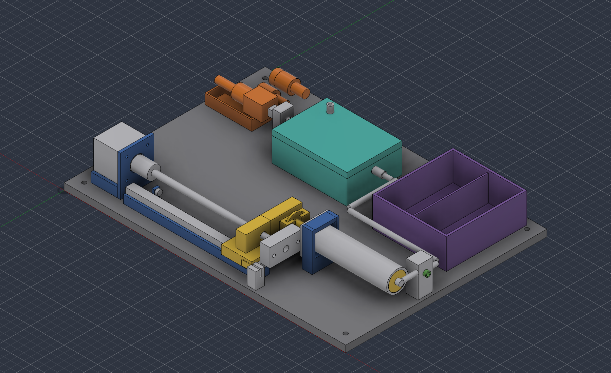
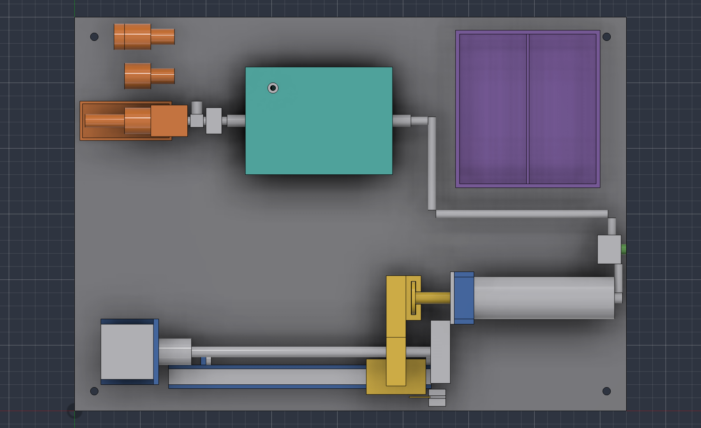
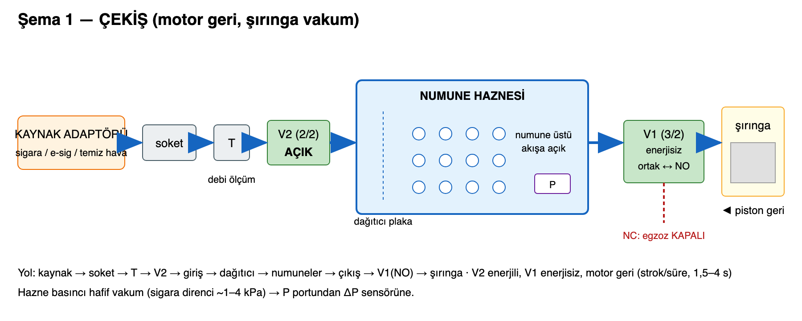
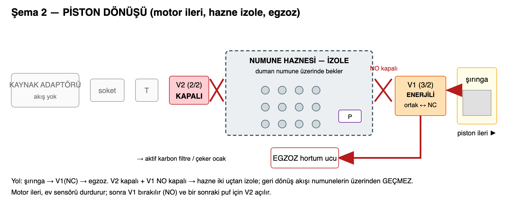
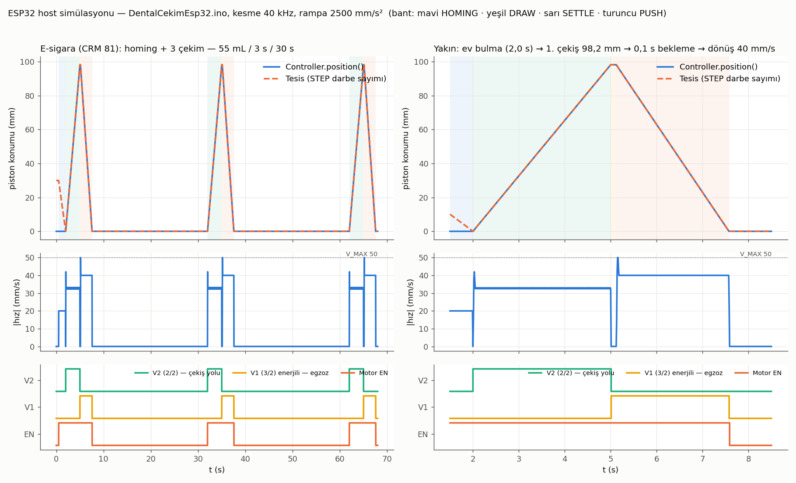
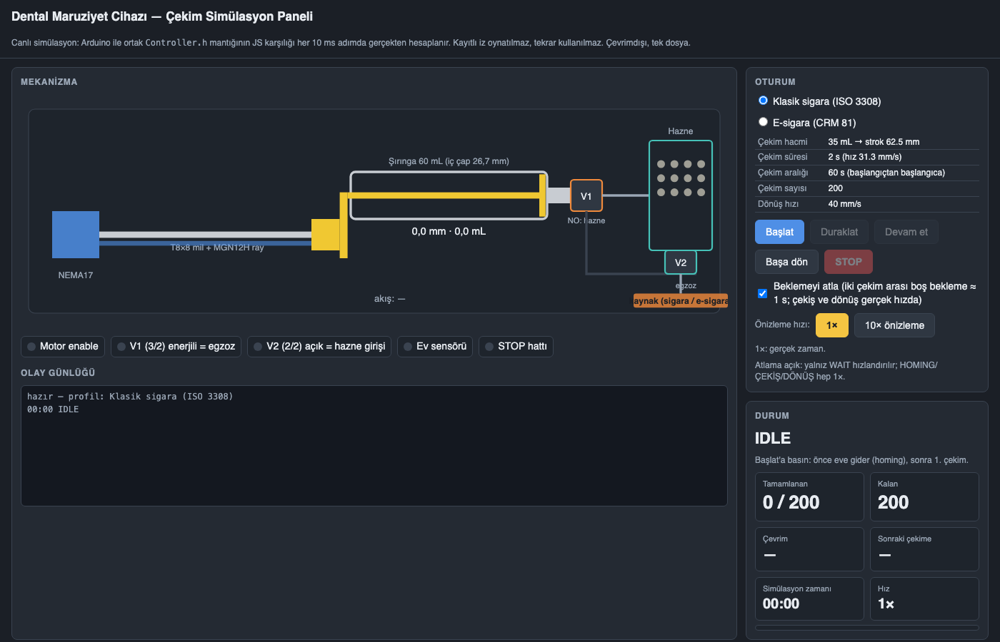

# Sigara dumanı / e-sigara aerosolü maruziyet cihazı — vitrin

Dental materyallerin renk değişimi deneyleri için tek kanallı, programlanabilir maruziyet cihazı prototipi.
Bu depo yalnız **vitrin**dir: görseller, tanıtım videosu ve dosya ağacı. Kaynak kod, tasarım dokümanı ve parça listesi özel depoda tutulur.

**Durum (13.11.2026):** 3B model ve kontrol yazılımı tamamlandı, bilgisayar simülasyonu geçti. Fiziksel prototip henüz üretilmedi; sızdırmazlık, debi ve hacim kalibrasyonu ölçülmedi.

## Ne yapar
Bir şırınga, motorla geri çekilerek sigaradan ya da e-sigaradan duman emer; duman 12 numunelik hazneden geçer. Şırınga boşaltılırken hazne kapalı kalır. Çevrim standart içim profiliyle 200 kez tekrarlanır:

| Profil | Hacim | Süre | Aralık |
|---|---|---|---|
| Klasik sigara (ISO 3308) | 35 mL | 2 s | 60 s |
| E-sigara (CORESTA CRM 81) | 55 mL | 3 s | 30 s |

## Tanıtım videosu
[cihaz_tanitim.mp4](cihaz_tanitim.mp4) — 3 dk 52 s, Türkçe seslendirme.

## Görseller
| | |
|---|---|
|  |  |
|  |  |
|  |  |

## Özel depodaki dosya ağacı (içerik paylaşılmaz)
```
OKUBENI.md                      proje özeti
TASARIM.md                      tasarım kararları, parametreler, strok hesabı, yerleşim
PARCA_LISTESI.md                ön BOM
ISTER_RAPORU.md / .pdf          30 ister, durum ve kanıt
semalar/                        çekiş + dönüş akış şemaları (SVG, ASCII)
fusion360/
  DumanMaruziyet.py             Fusion 360 API betiği — parametrik model (50 parça)
  kopru/                        Fusion ↔ betik köprüsü
  cikti/                        .f3d modeller, kontrol raporları, renderlar
satin_alinan/step/              hazır parça STEP dosyaları (NEMA17, MGN12H, T8, KFL08, …)
kontrol_paneli/
  Controller.h                  durum makinesi (C++)
  controller.js                 aynı makine (JS, panele gömülü)
  Dental_Cihaz_Simulasyon_Paneli.html   tek dosya, çevrimdışı simülasyon paneli
  arduino/DentalCekimEsp32/     ESP32 yazılımı + PlatformIO
  test/                         parite testleri, panel testleri, ESP32 host simülasyonu
sunum/
  yap_video.py                  tanıtım videosu üreticisi
  cihaz_tanitim.mp4
```

## Yazılım yapısı
Tek durum makinesi (IDLE → HOMING → (ÇEKİŞ → VALF GEÇİŞİ → BOŞALTMA → BEKLEME) × 200 → DONE; DURAKLAT, HATA) üç yerde koşar: tarayıcı paneli, ESP32, bilgisayar simülasyonu. C++ ve JS kopyaları 37 parite kontrolü ve 6 senaryo iziyle birebir doğrulanır.

İletişim: GitHub profil sayfasından.
